# Gantt Round Robin (q=3) — Ejercicio 1

## Diagrama de Gantt Round Robin q=3

```mermaid
gantt
    dateFormat X
    axisFormat %s
    title Gantt Round Robin q=3 (eje = unidades de tiempo)
    section P1
    P1 t0-3 :0, 3
    P1 t11-14 :11, 14
    P1 t33-36 :33, 36
    P1 t45-46 :45, 46
    section P2
    P2 t3-6 :3, 6
    P2 t23-24 :23, 24
    section P3
    P3 t6-9 :6, 9
    P3 t30-33 :30, 33
    P3 t44-45 :44, 45
    section P4
    P4 t9-11 :9, 11
    section P5
    P5 t14-17 :14, 17
    P5 t36-39 :36, 39
    P5 t46-49 :46, 49
    section P6
    P6 t17-20 :17, 20
    section P7
    P7 t20-23 :20, 23
    P7 t39-42 :39, 42
    section P8
    P8 t24-25 :24, 25
    section P9
    P9 t25-28 :25, 28
    P9 t42-44 :42, 44
    section P10
    P10 t28-30 :28, 30
```



Secuencia: `P1 P2 P3 P4 P1 P5 P6 P7 P2 P8 P9 P10 P3 P1 P5 P7 P9 P3 P1 P5`

| # | Proceso | Inicio | Fin | Duración |
|---:|---|---:|---:|---:|
| 1 | P1 | 0 | 3 | 3 |
| 2 | P2 | 3 | 6 | 3 |
| 3 | P3 | 6 | 9 | 3 |
| 4 | P4 | 9 | 11 | 2 |
| 5 | P1 | 11 | 14 | 3 |
| 6 | P5 | 14 | 17 | 3 |
| 7 | P6 | 17 | 20 | 3 |
| 8 | P7 | 20 | 23 | 3 |
| 9 | P2 | 23 | 24 | 1 |
| 10 | P8 | 24 | 25 | 1 |
| 11 | P9 | 25 | 28 | 3 |
| 12 | P10 | 28 | 30 | 2 |
| 13 | P3 | 30 | 33 | 3 |
| 14 | P1 | 33 | 36 | 3 |
| 15 | P5 | 36 | 39 | 3 |
| 16 | P7 | 39 | 42 | 3 |
| 17 | P9 | 42 | 44 | 2 |
| 18 | P3 | 44 | 45 | 1 |
| 19 | P1 | 45 | 46 | 1 |
| 20 | P5 | 46 | 49 | 3 |

Línea de tiempo (una columna por unidad; la columna `t` es el instante inicial):

```
t  :   0   1   2   3   4   5   6   7   8   9  10  11  12  13  14  15  16  17  18  19  20  21  22  23  24  25  26  27  28  29  30  31  32  33  34  35  36  37  38  39  40  41  42  43  44  45  46  47  48
CPU:  P1  P1  P1  P2  P2  P2  P3  P3  P3  P4  P4  P1  P1  P1  P5  P5  P5  P6  P6  P6  P7  P7  P7  P2  P8  P9  P9  P9 P10 P10  P3  P3  P3  P1  P1  P1  P5  P5  P5  P7  P7  P7  P9  P9  P3  P1  P5  P5  P5
fin: t=49
```
