# Gantt SRTF — Ejercicio 1

## Diagrama de Gantt SRTF

```mermaid
gantt
    dateFormat X
    axisFormat %s
    title Gantt SRTF (eje = unidades de tiempo)
    section P1
    P1 t0-1 :0, 1
    P1 t31-40 :31, 40
    section P2
    P2 t1-5 :1, 5
    section P3
    P3 t24-31 :24, 31
    section P4
    P4 t5-7 :5, 7
    section P5
    P5 t40-49 :40, 49
    section P6
    P6 t8-11 :8, 11
    section P7
    P7 t18-24 :18, 24
    section P8
    P8 t7-8 :7, 8
    section P9
    P9 t13-18 :13, 18
    section P10
    P10 t11-13 :11, 13
```



Secuencia: `P1 P2 P4 P8 P6 P10 P9 P7 P3 P1 P5`

| # | Proceso | Inicio | Fin | Duración |
|---:|---|---:|---:|---:|
| 1 | P1 | 0 | 1 | 1 |
| 2 | P2 | 1 | 5 | 4 |
| 3 | P4 | 5 | 7 | 2 |
| 4 | P8 | 7 | 8 | 1 |
| 5 | P6 | 8 | 11 | 3 |
| 6 | P10 | 11 | 13 | 2 |
| 7 | P9 | 13 | 18 | 5 |
| 8 | P7 | 18 | 24 | 6 |
| 9 | P3 | 24 | 31 | 7 |
| 10 | P1 | 31 | 40 | 9 |
| 11 | P5 | 40 | 49 | 9 |

Línea de tiempo (una columna por unidad; la columna `t` es el instante inicial):

```
t  :   0   1   2   3   4   5   6   7   8   9  10  11  12  13  14  15  16  17  18  19  20  21  22  23  24  25  26  27  28  29  30  31  32  33  34  35  36  37  38  39  40  41  42  43  44  45  46  47  48
CPU:  P1  P2  P2  P2  P2  P4  P4  P8  P6  P6  P6 P10 P10  P9  P9  P9  P9  P9  P7  P7  P7  P7  P7  P7  P3  P3  P3  P3  P3  P3  P3  P1  P1  P1  P1  P1  P1  P1  P1  P1  P5  P5  P5  P5  P5  P5  P5  P5  P5
fin: t=49
```
