# Ejercicio 2 — Llegadas continuas

[← Entrega del equipo](../../../README.md)

Nicolás Portilla: FIFO y SJF, tablas y análisis no apropiativo. Luis Felipe: SRTF y RR q=2, procesos cortos frente a largos y quantum. Síntesis comparativa y revisión: integración del equipo.

## Entrega integrada

- [Excel: cuatro algoritmos, resumen y cola RR](Ejercicio_2.xlsx)
- [Conclusión comparativa](Conclusion_Ejercicio_2.docx)

## Criterios comunes

Una ráfaga por proceso; sin E/S ni costo de cambio de contexto. Intervalos [inicio, fin). Desempates: llegada y luego identificador. RR usa quantum 2; las llegadas al vencer el quantum entran antes de la reincorporación.

## Promedios

| Algoritmo | Espera | Retorno | Respuesta | Responsable |
|---|---:|---:|---:|---|
| FIFO | 18.90 | 23.30 | 18.90 | Nicolás Portilla |
| SJF | 14.00 | 18.40 | 14.00 | Nicolás Portilla |
| SRTF | 7.90 | 12.30 | 4.60 | Luis Felipe |
| RR q=2 | 16.70 | 21.10 | 5.80 | Luis Felipe |

## FIFO — Nicolás Portilla

| Proceso | Llegada | Ráfaga | Inicio | Finalización | Espera | Retorno | Respuesta |
|---|---:|---:|---:|---:|---:|---:|---:|
| P1 | 0 | 12 | 0 | 12 | 0 | 12 | 0 |
| P2 | 1 | 3 | 12 | 15 | 11 | 14 | 11 |
| P3 | 2 | 1 | 15 | 16 | 13 | 14 | 13 |
| P4 | 3 | 8 | 16 | 24 | 13 | 21 | 13 |
| P5 | 4 | 2 | 24 | 26 | 20 | 22 | 20 |
| P6 | 5 | 6 | 26 | 32 | 21 | 27 | 21 |
| P7 | 6 | 1 | 32 | 33 | 26 | 27 | 26 |
| P8 | 7 | 4 | 33 | 37 | 26 | 30 | 26 |
| P9 | 8 | 2 | 37 | 39 | 29 | 31 | 29 |
| P10 | 9 | 5 | 39 | 44 | 30 | 35 | 30 |
| **Promedio** | | | | | **18.90** | **23.30** | **18.90** |

## Diagrama de Gantt FIFO

```mermaid
gantt
    dateFormat X
    axisFormat %s
    title Gantt FIFO (eje = unidades de tiempo)
    section P1
    P1 t0-12 :0, 12
    section P2
    P2 t12-15 :12, 15
    section P3
    P3 t15-16 :15, 16
    section P4
    P4 t16-24 :16, 24
    section P5
    P5 t24-26 :24, 26
    section P6
    P6 t26-32 :26, 32
    section P7
    P7 t32-33 :32, 33
    section P8
    P8 t33-37 :33, 37
    section P9
    P9 t37-39 :37, 39
    section P10
    P10 t39-44 :39, 44
```



Secuencia: `P1 P2 P3 P4 P5 P6 P7 P8 P9 P10`

| # | Proceso | Inicio | Fin | Duración |
|---:|---|---:|---:|---:|
| 1 | P1 | 0 | 12 | 12 |
| 2 | P2 | 12 | 15 | 3 |
| 3 | P3 | 15 | 16 | 1 |
| 4 | P4 | 16 | 24 | 8 |
| 5 | P5 | 24 | 26 | 2 |
| 6 | P6 | 26 | 32 | 6 |
| 7 | P7 | 32 | 33 | 1 |
| 8 | P8 | 33 | 37 | 4 |
| 9 | P9 | 37 | 39 | 2 |
| 10 | P10 | 39 | 44 | 5 |

Línea de tiempo (una columna por unidad; la columna `t` es el instante inicial):

```
t  :   0   1   2   3   4   5   6   7   8   9  10  11  12  13  14  15  16  17  18  19  20  21  22  23  24  25  26  27  28  29  30  31  32  33  34  35  36  37  38  39  40  41  42  43
CPU:  P1  P1  P1  P1  P1  P1  P1  P1  P1  P1  P1  P1  P2  P2  P2  P3  P4  P4  P4  P4  P4  P4  P4  P4  P5  P5  P6  P6  P6  P6  P6  P6  P7  P8  P8  P8  P8  P9  P9 P10 P10 P10 P10 P10
fin: t=44
```

## SJF — Nicolás Portilla

| Proceso | Llegada | Ráfaga | Inicio | Finalización | Espera | Retorno | Respuesta |
|---|---:|---:|---:|---:|---:|---:|---:|
| P1 | 0 | 12 | 0 | 12 | 0 | 12 | 0 |
| P2 | 1 | 3 | 18 | 21 | 17 | 20 | 17 |
| P3 | 2 | 1 | 12 | 13 | 10 | 11 | 10 |
| P4 | 3 | 8 | 36 | 44 | 33 | 41 | 33 |
| P5 | 4 | 2 | 14 | 16 | 10 | 12 | 10 |
| P6 | 5 | 6 | 30 | 36 | 25 | 31 | 25 |
| P7 | 6 | 1 | 13 | 14 | 7 | 8 | 7 |
| P8 | 7 | 4 | 21 | 25 | 14 | 18 | 14 |
| P9 | 8 | 2 | 16 | 18 | 8 | 10 | 8 |
| P10 | 9 | 5 | 25 | 30 | 16 | 21 | 16 |
| **Promedio** | | | | | **14.00** | **18.40** | **14.00** |

## Diagrama de Gantt SJF

```mermaid
gantt
    dateFormat X
    axisFormat %s
    title Gantt SJF (eje = unidades de tiempo)
    section P1
    P1 t0-12 :0, 12
    section P2
    P2 t18-21 :18, 21
    section P3
    P3 t12-13 :12, 13
    section P4
    P4 t36-44 :36, 44
    section P5
    P5 t14-16 :14, 16
    section P6
    P6 t30-36 :30, 36
    section P7
    P7 t13-14 :13, 14
    section P8
    P8 t21-25 :21, 25
    section P9
    P9 t16-18 :16, 18
    section P10
    P10 t25-30 :25, 30
```



Secuencia: `P1 P3 P7 P5 P9 P2 P8 P10 P6 P4`

| # | Proceso | Inicio | Fin | Duración |
|---:|---|---:|---:|---:|
| 1 | P1 | 0 | 12 | 12 |
| 2 | P3 | 12 | 13 | 1 |
| 3 | P7 | 13 | 14 | 1 |
| 4 | P5 | 14 | 16 | 2 |
| 5 | P9 | 16 | 18 | 2 |
| 6 | P2 | 18 | 21 | 3 |
| 7 | P8 | 21 | 25 | 4 |
| 8 | P10 | 25 | 30 | 5 |
| 9 | P6 | 30 | 36 | 6 |
| 10 | P4 | 36 | 44 | 8 |

Línea de tiempo (una columna por unidad; la columna `t` es el instante inicial):

```
t  :   0   1   2   3   4   5   6   7   8   9  10  11  12  13  14  15  16  17  18  19  20  21  22  23  24  25  26  27  28  29  30  31  32  33  34  35  36  37  38  39  40  41  42  43
CPU:  P1  P1  P1  P1  P1  P1  P1  P1  P1  P1  P1  P1  P3  P7  P5  P5  P9  P9  P2  P2  P2  P8  P8  P8  P8 P10 P10 P10 P10 P10  P6  P6  P6  P6  P6  P6  P4  P4  P4  P4  P4  P4  P4  P4
fin: t=44
```

## SRTF — Luis Felipe

| Proceso | Llegada | Ráfaga | Inicio | Finalización | Espera | Retorno | Respuesta |
|---|---:|---:|---:|---:|---:|---:|---:|
| P1 | 0 | 12 | 0 | 44 | 32 | 44 | 0 |
| P2 | 1 | 3 | 1 | 5 | 1 | 4 | 0 |
| P3 | 2 | 1 | 2 | 3 | 0 | 1 | 0 |
| P4 | 3 | 8 | 25 | 33 | 22 | 30 | 22 |
| P5 | 4 | 2 | 5 | 7 | 1 | 3 | 1 |
| P6 | 5 | 6 | 19 | 25 | 14 | 20 | 14 |
| P7 | 6 | 1 | 7 | 8 | 1 | 2 | 1 |
| P8 | 7 | 4 | 10 | 14 | 3 | 7 | 3 |
| P9 | 8 | 2 | 8 | 10 | 0 | 2 | 0 |
| P10 | 9 | 5 | 14 | 19 | 5 | 10 | 5 |
| **Promedio** | | | | | **7.90** | **12.30** | **4.60** |

## Diagrama de Gantt SRTF

```mermaid
gantt
    dateFormat X
    axisFormat %s
    title Gantt SRTF (eje = unidades de tiempo)
    section P1
    P1 t0-1 :0, 1
    P1 t33-44 :33, 44
    section P2
    P2 t1-2 :1, 2
    P2 t3-5 :3, 5
    section P3
    P3 t2-3 :2, 3
    section P4
    P4 t25-33 :25, 33
    section P5
    P5 t5-7 :5, 7
    section P6
    P6 t19-25 :19, 25
    section P7
    P7 t7-8 :7, 8
    section P8
    P8 t10-14 :10, 14
    section P9
    P9 t8-10 :8, 10
    section P10
    P10 t14-19 :14, 19
```



Secuencia: `P1 P2 P3 P2 P5 P7 P9 P8 P10 P6 P4 P1`

| # | Proceso | Inicio | Fin | Duración |
|---:|---|---:|---:|---:|
| 1 | P1 | 0 | 1 | 1 |
| 2 | P2 | 1 | 2 | 1 |
| 3 | P3 | 2 | 3 | 1 |
| 4 | P2 | 3 | 5 | 2 |
| 5 | P5 | 5 | 7 | 2 |
| 6 | P7 | 7 | 8 | 1 |
| 7 | P9 | 8 | 10 | 2 |
| 8 | P8 | 10 | 14 | 4 |
| 9 | P10 | 14 | 19 | 5 |
| 10 | P6 | 19 | 25 | 6 |
| 11 | P4 | 25 | 33 | 8 |
| 12 | P1 | 33 | 44 | 11 |

Línea de tiempo (una columna por unidad; la columna `t` es el instante inicial):

```
t  :   0   1   2   3   4   5   6   7   8   9  10  11  12  13  14  15  16  17  18  19  20  21  22  23  24  25  26  27  28  29  30  31  32  33  34  35  36  37  38  39  40  41  42  43
CPU:  P1  P2  P3  P2  P2  P5  P5  P7  P9  P9  P8  P8  P8  P8 P10 P10 P10 P10 P10  P6  P6  P6  P6  P6  P6  P4  P4  P4  P4  P4  P4  P4  P4  P1  P1  P1  P1  P1  P1  P1  P1  P1  P1  P1
fin: t=44
```

## RR q=2 — Luis Felipe

| Proceso | Llegada | Ráfaga | Inicio | Finalización | Espera | Retorno | Respuesta |
|---|---:|---:|---:|---:|---:|---:|---:|
| P1 | 0 | 12 | 0 | 44 | 32 | 44 | 0 |
| P2 | 1 | 3 | 2 | 12 | 8 | 11 | 1 |
| P3 | 2 | 1 | 4 | 5 | 2 | 3 | 2 |
| P4 | 3 | 8 | 7 | 42 | 31 | 39 | 4 |
| P5 | 4 | 2 | 9 | 11 | 5 | 7 | 5 |
| P6 | 5 | 6 | 12 | 37 | 26 | 32 | 7 |
| P7 | 6 | 1 | 14 | 15 | 8 | 9 | 8 |
| P8 | 7 | 4 | 15 | 29 | 18 | 22 | 8 |
| P9 | 8 | 2 | 19 | 21 | 11 | 13 | 11 |
| P10 | 9 | 5 | 21 | 40 | 26 | 31 | 12 |
| **Promedio** | | | | | **16.70** | **21.10** | **5.80** |

## Diagrama de Gantt RR q=2

```mermaid
gantt
    dateFormat X
    axisFormat %s
    title Gantt RR q=2 (eje = unidades de tiempo)
    section P1
    P1 t0-2 :0, 2
    P1 t5-7 :5, 7
    P1 t17-19 :17, 19
    P1 t29-31 :29, 31
    P1 t37-39 :37, 39
    P1 t42-44 :42, 44
    section P2
    P2 t2-4 :2, 4
    P2 t11-12 :11, 12
    section P3
    P3 t4-5 :4, 5
    section P4
    P4 t7-9 :7, 9
    P4 t23-25 :23, 25
    P4 t33-35 :33, 35
    P4 t40-42 :40, 42
    section P5
    P5 t9-11 :9, 11
    section P6
    P6 t12-14 :12, 14
    P6 t25-27 :25, 27
    P6 t35-37 :35, 37
    section P7
    P7 t14-15 :14, 15
    section P8
    P8 t15-17 :15, 17
    P8 t27-29 :27, 29
    section P9
    P9 t19-21 :19, 21
    section P10
    P10 t21-23 :21, 23
    P10 t31-33 :31, 33
    P10 t39-40 :39, 40
```



Secuencia: `P1 P2 P3 P1 P4 P5 P2 P6 P7 P8 P1 P9 P10 P4 P6 P8 P1 P10 P4 P6 P1 P10 P4 P1`

| # | Proceso | Inicio | Fin | Duración |
|---:|---|---:|---:|---:|
| 1 | P1 | 0 | 2 | 2 |
| 2 | P2 | 2 | 4 | 2 |
| 3 | P3 | 4 | 5 | 1 |
| 4 | P1 | 5 | 7 | 2 |
| 5 | P4 | 7 | 9 | 2 |
| 6 | P5 | 9 | 11 | 2 |
| 7 | P2 | 11 | 12 | 1 |
| 8 | P6 | 12 | 14 | 2 |
| 9 | P7 | 14 | 15 | 1 |
| 10 | P8 | 15 | 17 | 2 |
| 11 | P1 | 17 | 19 | 2 |
| 12 | P9 | 19 | 21 | 2 |
| 13 | P10 | 21 | 23 | 2 |
| 14 | P4 | 23 | 25 | 2 |
| 15 | P6 | 25 | 27 | 2 |
| 16 | P8 | 27 | 29 | 2 |
| 17 | P1 | 29 | 31 | 2 |
| 18 | P10 | 31 | 33 | 2 |
| 19 | P4 | 33 | 35 | 2 |
| 20 | P6 | 35 | 37 | 2 |
| 21 | P1 | 37 | 39 | 2 |
| 22 | P10 | 39 | 40 | 1 |
| 23 | P4 | 40 | 42 | 2 |
| 24 | P1 | 42 | 44 | 2 |

Línea de tiempo (una columna por unidad; la columna `t` es el instante inicial):

```
t  :   0   1   2   3   4   5   6   7   8   9  10  11  12  13  14  15  16  17  18  19  20  21  22  23  24  25  26  27  28  29  30  31  32  33  34  35  36  37  38  39  40  41  42  43
CPU:  P1  P1  P2  P2  P3  P1  P1  P4  P4  P5  P5  P2  P6  P6  P7  P8  P8  P1  P1  P9  P9 P10 P10  P4  P4  P6  P6  P8  P8  P1  P1 P10 P10  P4  P4  P6  P6  P1  P1 P10  P4  P4  P1  P1
fin: t=44
```

## Registro de Round Robin

24 turnos; 14 reincorporaciones. La cola se muestra después de admitir llegadas y reincorporar el proceso si aún le queda CPU.

| Inicio | Proceso | Duración | Fin | Restante | Nuevos | Reincorpora | Cola al terminar |
|---:|---|---:|---:|---:|---|---|---|
| 0 | P1 | 2 | 2 | 10 | P2, P3 | Sí | P2, P3, P1 |
| 2 | P2 | 2 | 4 | 1 | P4, P5 | Sí | P3, P1, P4, P5, P2 |
| 4 | P3 | 1 | 5 | 0 | P6 | No | P1, P4, P5, P2, P6 |
| 5 | P1 | 2 | 7 | 8 | P7, P8 | Sí | P4, P5, P2, P6, P7, P8, P1 |
| 7 | P4 | 2 | 9 | 6 | P9, P10 | Sí | P5, P2, P6, P7, P8, P1, P9, P10, P4 |
| 9 | P5 | 2 | 11 | 0 | — | No | P2, P6, P7, P8, P1, P9, P10, P4 |
| 11 | P2 | 1 | 12 | 0 | — | No | P6, P7, P8, P1, P9, P10, P4 |
| 12 | P6 | 2 | 14 | 4 | — | Sí | P7, P8, P1, P9, P10, P4, P6 |
| 14 | P7 | 1 | 15 | 0 | — | No | P8, P1, P9, P10, P4, P6 |
| 15 | P8 | 2 | 17 | 2 | — | Sí | P1, P9, P10, P4, P6, P8 |
| 17 | P1 | 2 | 19 | 6 | — | Sí | P9, P10, P4, P6, P8, P1 |
| 19 | P9 | 2 | 21 | 0 | — | No | P10, P4, P6, P8, P1 |
| 21 | P10 | 2 | 23 | 3 | — | Sí | P4, P6, P8, P1, P10 |
| 23 | P4 | 2 | 25 | 4 | — | Sí | P6, P8, P1, P10, P4 |
| 25 | P6 | 2 | 27 | 2 | — | Sí | P8, P1, P10, P4, P6 |
| 27 | P8 | 2 | 29 | 0 | — | No | P1, P10, P4, P6 |
| 29 | P1 | 2 | 31 | 4 | — | Sí | P10, P4, P6, P1 |
| 31 | P10 | 2 | 33 | 1 | — | Sí | P4, P6, P1, P10 |
| 33 | P4 | 2 | 35 | 2 | — | Sí | P6, P1, P10, P4 |
| 35 | P6 | 2 | 37 | 0 | — | No | P1, P10, P4 |
| 37 | P1 | 2 | 39 | 2 | — | Sí | P10, P4, P1 |
| 39 | P10 | 1 | 40 | 0 | — | No | P4, P1 |
| 40 | P4 | 2 | 42 | 0 | — | No | P1 |
| 42 | P1 | 2 | 44 | 0 | — | No | Vacía |

## Conclusión comparativa

SRTF obtiene los menores promedios de espera (7,90), retorno (12,30) y respuesta (4,60). SJF queda segundo en espera y retorno (14,00 y 18,40), seguido por RR q=2 (16,70 y 21,10) y FIFO (18,90 y 23,30). En respuesta, RR (5,80) supera a SJF (14,00) y FIFO (18,90). Todos terminan en t=44.

P1, con ráfaga 12, ejecuta [0,12) sin interrupción en FIFO y SJF. En SRTF es expropiado en t=1 y reanuda en t=33 para terminar en t=44: su espera es 32. Los cortos P2, P3 y P9 tienen respuesta 0 en SRTF. RR permite que P1 reciba turnos durante la ejecución del resto, aunque también termina en t=44.

P4 llega en t=3 y tiene ráfaga 8. En FIFO ejecuta [16,24), con respuesta 13. SJF lo posterga a [36,44), con respuesta 33. En SRTF ejecuta [25,33), con respuesta 22. RR le da su primer turno en t=7, respuesta 4, y termina en t=42: mejora su acceso inicial a costa de retorno y espera mayores que SRTF.

Con quantum 2, RR produce 24 turnos y 14 reincorporaciones. Las ráfagas de hasta 2 unidades terminan en un turno. Un quantum menor reparte el acceso en turnos más cortos y puede aumentar las interrupciones; uno mayor aproxima RR a FIFO. Aquí los cambios no tienen costo por supuesto del enunciado. Las llegadas exactamente al vencer el quantum se encolan antes del proceso interrumpido.

RR ofrece acceso periódico y evita inanición para esta carga, con respuesta máxima 12 frente a 22 de SRTF. SRTF y SJF postergan procesos largos y podrían provocar inanición bajo llegadas continuas de trabajos cortos; en estos datos finitos todos terminan. SRTF conviene si se priorizan los promedios; RR si interesa repartir el acceso y reducir la peor respuesta. Solo un proceso usa la CPU por instante.

## Aportes y revisión

- [Nicolás Portilla: Excel revisado](aportes/nicolas-portilla/Ejercicio_2_FIFO_y_SJF.xlsx) y [conclusión parcial](aportes/nicolas-portilla/Conclusion_FIFO_y_SJF.docx), conservados como antecedente previo a integrar a Luis.
- [Luis Felipe: Excel recibido](aportes/luis-felipe/ejercicio_2.xlsx) y [análisis recibido](aportes/luis-felipe/ejercicio_2.docx), conservados sin modificaciones.
- Sus métricas SRTF y RR coinciden con la comprobación por unidad de tiempo. En la entrega integrada se corrigieron Gantt intercambiados y etiquetas P11/P12; se completaron promedios y registro de cola.
- El análisis integrado corrige P1: ráfaga 12, finalización 44; espera RR 16,70. Se distingue ejecución simultánea de procesos pendientes y riesgo de inanición de postergación efectiva.
